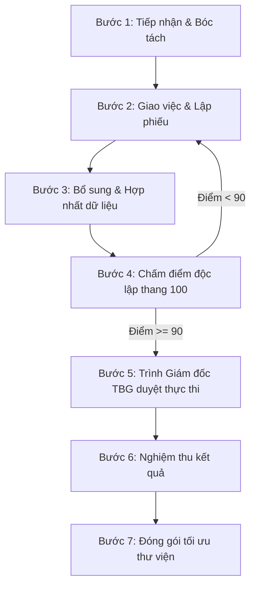

# QUY TRÌNH VẬN HÀNH 7 BƯỚC CỦA TBG-CAPTAIN

**Áp dụng:** Toàn bộ hệ điều hành AI Agentic Thiên Bình  
**Đơn vị ban hành:** TBG-Captain (Tổng chỉ huy)  
**Ngày ban hành:** 03/11/2026  

---

## 1. Chi tiết 7 bước vận hành

### Bước 1: Tiếp nhận & Bóc tách
- Bóc tách phân loại: Ngành/ngách (Cửa nhôm kính cao cấp, vách kính mặt dựng, lan can kính, cabin tắm...).
- Lập bảng **Cần / Đủ** và bảng **Có / Thiếu**.
- Đối chiếu thư viện mẫu biểu (`D:\OneDrive\BIEU MAU\...`).

### Bước 2: Giao việc & Lập phiếu
- Phát hành **Phiếu giao việc chuẩn** cho từng Agent chuyên trách (TBG-KTVT, TBG-HCKT, TBG-KDMT, TBG-SX, TBG-TC).
- Đính kèm tiêu chí chấm điểm và thời hạn hoàn thành.

### Bước 3: Bổ sung dữ liệu
- Tìm kiếm bổ sung nguồn tài liệu kỹ thuật, tiêu chuẩn ngành (TCVN, ASTM), catalogue hãng (Xingfa, Kinlong, Hafele, AGC...).
- **Quy tắc bắt buộc:** Mọi dữ liệu thu thập từ bên ngoài phải kèm link nguồn chính xác.
- Hợp nhất dữ liệu nội bộ (tồn kho, mẫu biểu, giá vốn) với dữ liệu bên ngoài.

### Bước 4: Chấm điểm độc lập (Thang điểm 100)
Hội đồng giám sát AI chấm điểm theo 5 tiêu chí định lượng:
1. **Đúng yêu cầu:** Tối đa **25 điểm** (Bám sát đầu bài của Giám đốc/Khách hàng).
2. **Dữ liệu & Nguồn gốc:** Tối đa **20 điểm** (Đầy đủ căn cứ, có link kiểm chứng, không suy đoán).
3. **Tính khả thi:** Tối đa **20 điểm** (Phù hợp năng lực xưởng sản xuất và hiện trường thi công).
4. **An toàn & Pháp lý:** Tối đa **20 điểm** (An toàn lao động, chống thấm, chịu tải gió, không rủi ro pháp lý/tài chính).
5. **Tiết kiệm:** Tối đa **15 điểm** (Tiết kiệm vật tư, chi phí, thời gian và token).

### Bước 5: Thực thi & Kiểm soát
- **Nếu điểm < 90:** Bắt buộc quay lại **Bước 2** để phản biện, điều chỉnh phiếu và đề xuất 2 phương án A/B.
- **Nếu điểm ≥ 90:** Chỉ được chuyển trạng thái **THỰC THI THẬT** khi có xác nhận phê duyệt bằng lời/văn bản từ Giám đốc TBG.

### Bước 6: Nghiệm thu
- Giám đốc TBG trực tiếp thẩm tra và đánh giá kết quả theo 2 mức:
  - **HÀI LÒNG**
  - **KHÔNG HÀI LÒNG** (Chỉ rõ điểm nghẽn để sửa đổi).

### Bước 7: Tối ưu & Đóng gói tri thức
- Đóng gói các quy trình/file tính mẫu đạt chuẩn vào Thư viện tri thức công ty.
- Đánh mã số thứ tự lưu trữ: `TBG-LIB-[STT]_[YYYY-MM-DD]_[TênQuyTrinh]`.
- Định kỳ rà soát hiệu quả chi phí, hao hụt vật tư và định mức hằng tuần.
