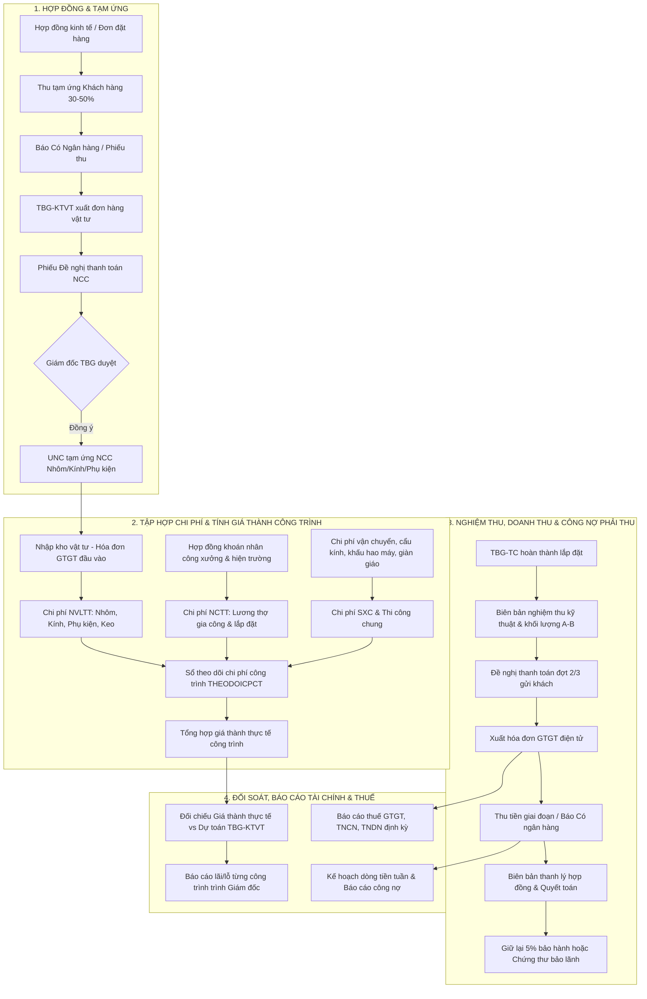

# SƠ ĐỒ HOÁ QUY TRÌNH KẾ TOÁN DOANH NGHIỆP NHÔM KÍNH — THIÊN BÌNH

**Đơn vị thực hiện:** TBG-HCKT (Hành chính & Kế toán)  
**Đơn vị điều phối:** TBG-Captain (Tổng chỉ huy)  
**Phê duyệt:** Giám đốc TBG  
**Ngày ban hành:** 04/11/2026  

---

## 1. SƠ ĐỒ TỔNG THỂ DÒNG TIỀN & CHỨNG TỪ THEO VÒNG ĐỜI DỰ ÁN

---

## 2. MA TRẬN 4 PHÂN HỆ KẾ TOÁN CHI TIẾT

### Phân hệ 1: Kế toán Doanh thu & Công nợ Phải thu (AR)
- **Căn cứ chứng từ:** Hợp đồng kinh tế, Phụ lục hợp đồng phát sinh, Biên bản nghiệm thu (BBNT) bàn giao giai đoạn/toàn phần, Biên bản xác nhận khối lượng.
- **Biểu mẫu nội bộ áp dụng:**
  - `D:\OneDrive\BIEU MAU\KE TOAN\DE NGHI THANH TOAN - qt ...docx`
  - `D:\OneDrive\BIEU MAU\KE TOAN\BIEN BAN DOI CHIEU CONG NO.docx`
  - `D:\OneDrive\BIEU MAU\KE TOAN\BB TLHD Hop.doc`
  - Hóa đơn điện tử đầu ra: `D:\OneDrive\BIEU MAU\KE TOAN\mau hoa don - truoc`
- **Quy tắc thanh toán chuẩn ngành nhôm kính:**
  + Đợt 1 (Tạm ứng ký HĐ): 30% – 50% (để đặt nhôm & kính).
  + Đợt 2 (Hàng tập kết chân công trình): 30% – 40% (sau khi TBG-SX xuất xưởng và TBG-TC nhận hàng).
  + Đợt 3 (Lắp đặt hoàn thiện & Nghiệm thu): Thanh toán đến 95% – 100%.
  + Bảo hành: 5% giữ lại trong 12 tháng hoặc thay thế bằng Thư bảo lãnh bảo hành ngân hàng.

---

### Phân hệ 2: Kế toán Mua hàng & Công nợ Phải trả (AP)
- **Đối tượng:** Nhà cung cấp nhôm thanh định hình (Xingfa, PMA...), nhà máy tôi kính (Hải Long, Hồng Phúc, Á Châu...), phụ kiện (Kinlong, Draho, Hafele...), vật tư phụ (keo Dow Corning, Apollo, ốc vít inox).
- **Căn cứ chứng từ:**
  - `D:\OneDrive\BIEU MAU\KE TOAN\HOP DONG NGUYEN TAC\...` (Hợp đồng nguyên tắc với nhà cung ứng nhôm/kính).
  - Phiếu đề nghị thanh toán NCC kèm bảng bóc tách của TBG-KTVT.
  - Phiếu nhập kho của TBG-SX, biên bản giao nhận hàng và hóa đơn GTGT đầu vào.
- **Quy chế kiểm soát chi:** Mọi khoản chi tiền mặt hoặc chuyển khoản ngân hàng **bắt buộc** phải có chữ ký duyệt của Giám đốc TBG. Tuyệt đối không tự ý giải ngân.

---

### Phân hệ 3: Kế toán Giá thành Công trình (Job Order Costing)
- **Mã hóa chi phí:** Mỗi công trình được cấp 1 Mã Dự Án (VD: `DA-ANKHANH-26`).
- **Tập hợp chi phí theo 3 tài khoản nghiệp vụ:**
  1. **Chi phí NVL trực tiếp (TK 621 / 1541):** Căn cứ theo Phiếu xuất kho vật tư nhôm kính đối chiếu định mức bóc tách ban đầu.
  2. **Chi phí Nhân công trực tiếp (TK 622 / 1542):** 
     - Lương công nhân xưởng sản xuất theo bảng chấm công sản phẩm.
     - Chi phí tổ đội thi công ngoài hiện trường theo `D:\OneDrive\BIEU MAU\KE TOAN\HOP DONG NHAN CONG` và nghiệm thu hoàn thành.
  3. **Chi phí Sản xuất & Thi công chung (TK 627 / 1543):**
     - Khấu hao máy cắt 2 đầu, máy ép góc, máy phay đố.
     - Cước xe cẩu chở kính, thuê giàn giáo, điện nước xưởng và công trường.
- **Biểu mẫu cốt lõi:** Quản lý tập trung qua `D:\OneDrive\BIEU MAU\KE TOAN\THEODOICPCT17.xlsx` (Sổ theo dõi chi phí công trình).
- **Chỉ tiêu đánh giá hiệu quả:** So sánh `Giá thành thực tế` với `Dự toán KTVT ban đầu`. Nếu vượt chi phí > 3% phải báo cáo giải trình nguyên nhân (do hao hụt nhôm, vỡ kính hay kéo dài tiến độ).

---

### Phân hệ 4: Kế toán Dòng tiền, Ngân hàng & Thuế
- **Quản trị dòng tiền (Treasury):**
  - Cập nhật số dư tài khoản ngân hàng hằng ngày (Techcombank, Vietcombank...).
  - Lập Kế hoạch dòng tiền thu - chi tuần/tháng nhằm đảm bảo luôn sẵn sàng tiền cọc phôi nhôm kính cho các công trình mới.
- **Kế toán Thuế:**
  - Kê khai thuế GTGT đầu vào - đầu ra theo quý.
  - Tạm tính thuế TNDN, quyết toán thuế TNCN nhân công thời vụ/khoán công trình theo đúng quy định Thông tư 111 & Thông tư 200/133.
